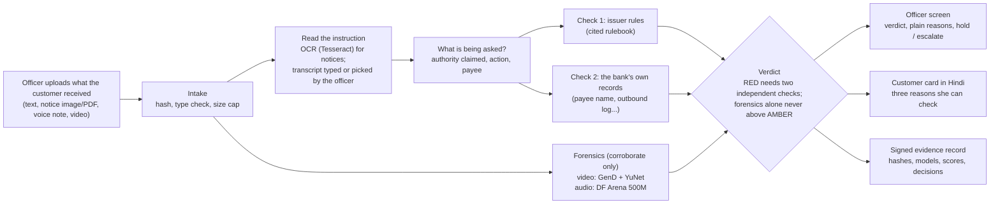
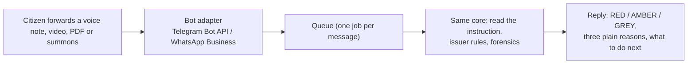

# Satyapan: architecture and finale plan

**Verify the instruction, not the pixels.** When a bank pauses a large, unusual transfer, Satyapan helps the officer
check the "official" voice note, video or notice behind it. A RED needs a cited issuer rule plus a second, independent
check; a deepfake flag can be that second check, but never decides alone; the officer always decides.

## 1. How a case flows

| Layer | What it does | Built where |
|---|---|---|
| Intake | Hash every file, check type and size | engine |
| Read the instruction | OCR for notices (Tesseract). Voice/video: the officer types or picks what was said (no speech-to-text model is declared) | engine |
| Two independent checks | Issuer rules with citations; the bank's own records (labelled mocks in the demo) | engine, `datasets/rules`, `datasets/mocks` |
| **Forensics (this repo)** | `forensics/video.py`: GenD on aligned faces (Aman). `forensics/audio.py`: DF Arena (Bhawna). Both calibrated on real clips, both abstain with a plain reason when unsure | **built live at the finale** |
| Verdict | RED needs a cited hard rule plus a second independent check. Forensics can raise AMBER at most | engine |
| Outputs | Officer screen, Hindi customer card, signed evidence record | engine, console |

### The forensics contract (both detectors)

`status` is `synthetic`, `clean` or `abstain`. Thresholds are set on **real** clips only, per calibration cell (e.g.
`video/sd` for WhatsApp-size video). A kind of input with no calibration abstains. Every result carries the model and
version, the cell, the score and the file hash, so it can go into the evidence record. Details: `docs/plan.md`, section 1.

### Where exactly the deepfake check sits

1. **When:** right after intake, on every uploaded voice note or video, in parallel with reading the instruction. It
   looks only at the media (faces, voice), never at what the message says.
2. **Code:** `forensics/video.py` → `GenDVideoForensics.analyse(path)`; `forensics/audio.py` → the audio detector. A
   video gets both: faces in the frames, and the voice in its sound track.
3. **Into the verdict:** each result becomes one "media forensics" signal (family F3) in the engine:

   | Detector says | Effect on the verdict |
   |---|---|
   | `synthetic` | A soft signal. Alone it can raise the case to **AMBER**, never higher. Together with a cited issuer rule (and a money demand read from the message) it can be the independent second check that makes **RED**: it rests on different evidence (the media, not the words) |
   | `clean` | Shown as "no signs found"; never lowers a verdict and never means "safe" |
   | `abstain` | Shown as "unsure: <reason>"; counts for nothing |

4. **On screen and in the record:** one plain line per detector on the officer screen; model, version, calibration
   cell, score and file hash in the signed evidence record.

**Wiring to do (Day 1, 17:00):** the engine currently maps every non-audio forensic result to the "document editing"
rule. Video needs its own rule (`R-VIDEO-SYNTH`, "Signs of face manipulation", family F3, soft) and its own route.

### Why forensics only corroborate

Open detectors lose about half their accuracy on deepfakes circulated in 2024 (Deepfake-Eval-2024, arXiv 2503.02857).
So a detector here never decides. It adds weight, says "unsure" when it should, and the officer sees a sentence, not a
score.

## 2. Finale plan (24–25 Oct)

Times are a guide; shift them to the organisers' schedule.

### Day 1 (today)

| Time (IST) | Aman: video | Bhawna: audio |
|---|---|---|
| until 14:00 | Video calibration run (Commons real clips + WhatsApp-like copies + face-swap pairs); report in `calibration/` | DF Arena loads and scores one note on the laptop; time measured |
| 14:00–17:00 | `forensics/analyse.py`: one entry point; a video runs the video check **and** the audio check on its sound track; `docs/consent.md` | `forensics/audio.py` wrapper + tests on the shared contract; calibration on Kathbath (real Hindi), IndicSynth (fake Hindi), In-the-Wild, WhatsApp-like Opus copies |
| 17:00–20:00 | Wire both detectors into the demo engine in place of the SIMULATED results; one plain line per detector on the officer screen; detector fields in the evidence record | Audio calibration report; join Aman on wiring |
| 20:00–22:00 | Demo clips: our own genuine selfie video (consented) and one labelled public face-swap sample | Demo clips: a genuine voice note of ours and one labelled synthetic Hindi sample |
| late | First full rehearsal; note every rough edge | same |

### Day 2

| When | Both |
|---|---|
| Morning | Fix rehearsal issues. Update the demo run-sheet and Q&A crib: we now run a real face-swap detector and a real voice-clone detector, with their measured catch rates and false-alarm rates (from `calibration/`, with sample sizes) |
| Midday | **Freeze.** Pre-demo check: detectors load offline, calibration files present, every scenario gives its expected verdict |
| Before the slot | Two full rehearsals. Phones silent, notifications off |

### Fallbacks

- A detector not calibrated in time ships as "unsure: not calibrated", and that scenario keeps its SIMULATED label.
- No internet at the venue: models load from the local cache (`HF_HUB_OFFLINE`), nothing calls a paid service.
- The screen fails: run the same scenarios in the terminal.

### What the demo shows (forensics beats)

1. Cloned voice note: the voice check flags it, and the two independent checks name the reasons (RED).
2. Face-swapped "officer" video: the face check flags it, and the sound track is checked too.
3. A blurry or tiny-face forward: the detector says "unsure", with the reason. It won't guess.
4. Our own genuine video: no signs found, and the screen says that this does not prove it is genuine.

## 3. Later add-on: WhatsApp / Telegram bot

A citizen forwards the suspicious voice note, video, PDF or summons to a bot and gets a verdict back. Same core, new
door:

Design rules for the bot (decide before building it):

- **No GREEN.** "No signs found" is not "genuine". A bot that says green on a deepfake sends money to the scammer. The
  replies are RED (the instruction could never be real), AMBER (warning signs) and GREY (couldn't confirm), always with
  "verify through the official channel" and the national cybercrime helpline, 1930.
- **No bank records.** A citizen bot has no access to the bank's own records, so RED rests on a cited issuer rule plus
  forensics or campaign memory; more cases will end GREY. That is honest.
- **No scores, rate limits.** A scammer could keep re-sending a deepfake until it passes. Coarse verdicts, no numbers,
  per-user limits.
- **Privacy.** Ask consent in the first message, analyse and delete the media, keep only hashes and the verdict.
- **Cost.** Telegram's Bot API is free. WhatsApp's Business Platform charges by message type; check current pricing
  before choosing it, given the no-paid-services rule for this event.
- **Load.** About 15 s of CPU per video; a queue keeps the bot responsive.

## 4. Rules we keep

- Only synthetic, public or consented data; no real official's face or voice in the demo.
- No paid APIs at run time; everything runs on the laptop.
- Every model is declared in `MODELS.md`; every dataset in `README.md`. Anything new gets declared in the same commit.
