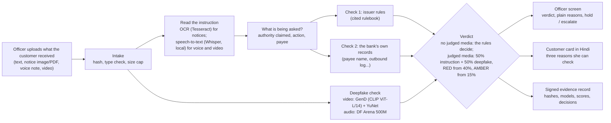
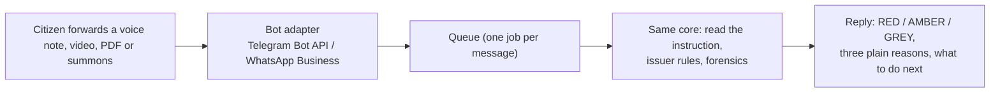

# Satyapan: architecture

**Verify the instruction, not just the pixels.** When a bank pauses a large, unusual transfer, Satyapan helps the officer
check the "official" voice note, video or notice behind it. The instruction checks and the deepfake check count half
each in a combined score (`docs/design-decisions.md`); the officer always decides.

## 1. How a case flows

| Layer | What it does | Built where |
|---|---|---|
| Intake | Hash every file, check type and size | engine |
| Read the instruction | OCR for notices (Tesseract). Voice/video: speech-to-text with Whisper (faster-whisper, local CPU, declared in `MODELS.md`); the officer can always correct or type it | engine |
| Two independent checks | Issuer rules with citations; the bank's own records (labelled mocks in the demo) | engine, `datasets/rules`, `datasets/mocks` |
| **Forensics (this repo)** | `forensics/video.py`: GenD (CLIP ViT-L/14 image encoder) on faces found and aligned by YuNet. `forensics/audio.py`: DF Arena. Both calibrated on real clips, both abstain with a plain reason when unsure | **built in this repository** |
| Verdict | No media, or media no detector could judge: the rules decide (RED needs a cited hard rule plus an independent second check). Judged media: 50% instruction + 50% deepfake, RED from 40%, AMBER from 15%; a RED still needs a money demand read (`docs/design-decisions.md`) | engine |
| Outputs | Officer screen, Hindi customer card, signed evidence record | engine, console |

### The forensics contract (both detectors)

`status` is `synthetic`, `clean` or `abstain`. Thresholds are set on **real** clips only, per calibration cell (e.g.
`video/sd` for WhatsApp-size video). A kind of input with no calibration abstains. Every result carries the model and
version, the cell, the score and the file hash, so it can go into the evidence record.

### Where exactly the deepfake check sits

1. **When:** right after intake, on every uploaded voice note or video, in parallel with reading the instruction. It
   looks only at the media (faces, voice), never at what the message says.
2. **Code:** `forensics/video.py` → `GenDVideoForensics.analyse(path)`; `forensics/audio.py` → the audio detector. A
   video gets both: faces in the frames, and the voice in its sound track.
3. **Into the verdict:** each result becomes one "media forensics" signal (family F3) in the engine:

   | Detector says | Effect on the verdict |
   |---|---|
   | `synthetic` | Deepfake % from the calibrated band: high 100, moderate 70. It counts half in the combined score. Video has no high band (too few genuine clips for a 1% line), so a face flag alone reaches 35% (AMBER). A voice flag can be high only in a cell with a 1% line (among the cells by channel, only 8 kHz Hindi phone audio): there it alone reaches 50%, RED when a money demand was read; elsewhere it is at most moderate, 35% alone (AMBER) |
   | `clean` | Deepfake 0%: the combined score is half the instruction %, which keeps the rules' verdict; shown as "no signs found", never "safe" |
   | `abstain` | Shown as "unsure: <reason>"; counted as no media, so the rules decide alone |

4. **On screen and in the record:** one plain line per detector on the officer screen; model, version, calibration
   cell, score and file hash in the signed evidence record.

**Wiring:** each kind of media has its own rule and route (`rule_for` in
`prototype/satyapan/forensics.py`): a face result maps to `R-VIDEO-SYNTH` ("Signs of face manipulation", family F3,
soft), a voice result to `R-AUDIO-SYNTH`, and a document to `R-DOC-TAMPER`, or to `R-DOC-AI` when the file's own label
names an AI tool.

### Why the deepfake check counts half, and only through calibration

Open detectors lose about half their accuracy on deepfakes circulated in 2024 (Deepfake-Eval-2024, arXiv 2503.02857).
So the deepfake % comes from calibrated bands, never a raw model score; "unsure" counts as no media; and the officer
sees the three numbers and a sentence on the band, never a score on the customer's card. Worked examples: `docs/design-decisions.md`.

## 2. Citizen bot: Telegram

A citizen forwards the suspicious voice note, video, PDF or summons to a bot and gets a verdict back. Same core, new
door:

**The Telegram bot** is in `bot/` (standard library only; setup, privacy and limits in `bot/README.md`).
`scripts/run_tg_bot.sh` starts its own engine on port 8100, connected to the forensics service when that answers,
then the bot. It follows the design rules below: consent first, RED / AMBER / GREY with no GREEN (a MATCHES case gets
GREY's words), no scores, 10 checks per user per hour, and the file and the engine's copy deleted after the reply.
Reasons resting on the bank's own records or on a mocked look-up (the I4C suspect registry, ED's verify-summon page)
are not shown to a citizen. Open: the verdict itself still comes from the engine with the demo bank's mocked records
switched on, so a RED can lean on them (bot/README.md, "Limits"). WhatsApp is not built.

Design rules for the bot:

- **No GREEN.** "No signs found" is not "genuine". A green reply on a deepfake would lead the citizen to pay the scammer. The
  replies are RED (the instruction could never be real), AMBER (warning signs) and GREY (couldn't confirm), always with
  "verify through the official channel" and the national cybercrime helpline, 1930.
- **No bank records.** A citizen bot has no access to the bank's own records, so RED rests on a cited issuer rule plus
  forensics or campaign memory, and more cases end GREY.
- **No scores, rate limits.** A scammer could keep re-sending a deepfake until it passes. Coarse verdicts, no numbers,
  per-user limits.
- **Privacy.** Ask consent in the first message, analyse and delete the media, keep only hashes and the verdict.
- **Cost.** Telegram's Bot API is free. WhatsApp's Business Platform charges by message type; check current pricing
  before choosing it, given the no-paid-services rule below.
- **Load.** About 15 s of CPU per video; a queue keeps the bot responsive.

## 3. Standing rules

- Only synthetic, public or consented data; no real official's face or voice in the demo.
- No paid APIs at run time; everything runs on the laptop.
- Every model is declared in `MODELS.md`; every dataset in `README.md`. Anything new gets declared in the same commit.
